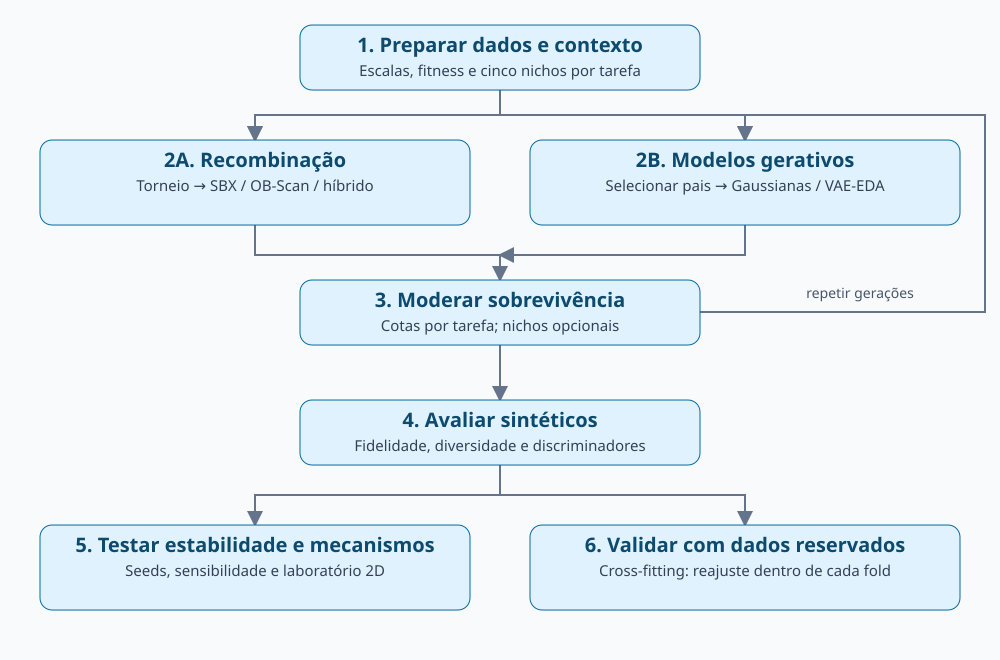

# Iris Generativa com NatGenAI

Experimento de geração de dados sintéticos inspirado em [Evolutionary Computation as Natural Generative AI](https://arxiv.org/html/2510.08590v1). A versão 2.3 compara seis condições, mantendo 50 registros por espécie da Iris: **SBX, OB-Scan-KDE, híbrido probabilístico, mistura gaussiana, mistura com produtos gaussianos e VAE-EDA condicional**.

O notebook principal é [`notebooks/Iris_Generativa_NatGenAI.ipynb`](notebooks/Iris_Generativa_NatGenAI.ipynb). Ele contém a explicação dos métodos, a pipeline e resultados do perfil rápido. As diferenças entre artigo e implementação estão em [docs/METODOLOGIA.md](docs/METODOLOGIA.md).

## Executar

```bash
python -m venv .venv
# Linux/macOS: source .venv/bin/activate
# Windows: .venv\Scripts\activate
python -m pip install -r requirements.txt
python -m pip install -e . --no-deps
jupyter notebook notebooks/Iris_Generativa_NatGenAI.ipynb
```

Os pins anteriores do projeto foram preservados em `requirements.txt`; foram acrescentados PyTorch e tqdm. O ambiente efetivamente utilizado nesta validação está em `requirements-validation.txt`. Para reproduzir esse ambiente, use esse arquivo no lugar de `requirements.txt`. PyTorch é usado em CPU; não há exigência de GPU.

Em `iris_generativa/config.py`, cada hiperparâmetro tem comentário explicativo. Configure antes de importar o pacote e reinicie o kernel após mudanças:

| Perfil | Gerações Iris | Épocas VAE por ajuste | Seeds de robustez | CV discriminativa | Árvores RF |
|---|---:|---:|---:|---|---:|
| `quick` (padrão) | 3 | 3 | 2 | 2 folds × 1 repetição | 32 |
| `full` | 40 | 30 | 20 | 5 folds × 5 repetições | 300 |

O cross-fitting mantém cinco folds externos e três internos nos dois perfis. A população principal permanece em 150 indivíduos; no cross-fitting, são 30 sintéticos por fold. `RUN_*` permite desligar laboratórios individualmente. `SHOW_PROGRESS=False` oculta barras sem alterar os resultados.

**O perfil rápido verifica funcionamento e não estabelece superioridade entre métodos.** O protocolo completo está implementado, mas não foi executado nesta entrega.

## Pipeline



1. Carregar dados, padronizar, calibrar fitness e formar cinco nichos por tarefa.
2. Gerar candidatos por crossover ou ajustar um modelo aos pais selecionados e amostrar.
3. Selecionar sobreviventes por tarefa, opcionalmente preservando nichos; repetir gerações.
4. Medir duplicação, coerência, novidade, diversidade, fidelidade marginal e distinguibilidade.
5. Comparar seeds, sensibilidade, políticas de seleção e cenários artificiais 2D.
6. Repetir o ajuste dentro de folds com reais reservados para avaliação.

O fitness permanece `0,50 P + 0,25 N + 0,25 C`. A novidade favorece uma distância-alvo ao real mais próximo; não cresce indefinidamente com a distância. O híbrido sorteia o operador por descendente, sem cota exata de 50/50. Nichos dinâmicos permanecem fora desta iteração.

## Implementação

| Arquivo | Responsabilidade |
|---|---|
| `config.py` | Hiperparâmetros, perfis e flags comentados |
| `data.py`, `fitness.py` | Dados, calibração e fitness por tarefa |
| `operators.py`, `evolution.py` | Operadores anteriores e seleção de sobreviventes |
| `gaussian.py` | Gaussianas por tarefa, misturas e produtos normalizados |
| `vae.py` | VAE condicional, treinamento e amostragem com RNG privado |
| `generative.py` | Interface comum e ciclo EDA |
| `benchmarks.py` | Cenários 2D, figuras e controle contrafactual da seleção |
| `evaluation.py` | Métricas e discriminadores |
| `extended_experiments.py` | Seis condições, robustez, sensibilidade e cross-fitting |
| `experiments.py` | API anterior preservada, agora com barras de progresso |
| `progress.py` | Exibição de progresso com tqdm |
| `tests/test_iteration.py` | Regressão, referências analíticas e isolamento |

As saídas incluem histórico de fitness, avaliações de fitness e tempo de geração. Novos geradores também registram componente de origem, clipping e sobrevivência dos candidatos; o VAE registra perdas por época. Os resultados da suíte guardam perfil, configuração, seeds e versões.

## Verificar

```bash
python -m pip install pytest
python -m pytest -q
```

O teste de regressão compara as três condições anteriores com o commit `ff2659f`; exige um clone com esse histórico Git. Os demais testes verificam os produtos gaussianos, reprodutibilidade, aprendizado do VAE, cotas, controles de seleção e exclusão dos dados reservados no cross-fitting.

Consulte [VALIDACAO.md](VALIDACAO.md) para resultados e limitações desta entrega. O uso da Iris é experimental: fidelidade e baixa distinguibilidade não demonstram validade biológica, privacidade ou criatividade fora da distribuição.
