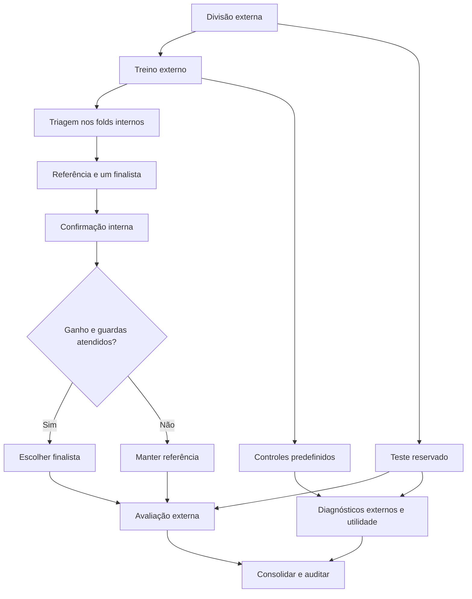

# Metodologias e decisões — estado consolidado da iteração 2.5

A base de geração abaixo corresponde aos padrões preservados desde a revisão 2.3.1. As alternativas 2.4/2.5 são opcionais e estão descritas ao final; sua disponibilidade não significa promoção a novo padrão.

Referência principal: [Evolutionary Computation as Natural Generative AI](https://arxiv.org/html/2510.08590v1), especialmente a discussão de moderação e os experimentos artificiais das seções VI-A/VI-B. A tradução fornecida pelo projeto foi utilizada como apoio de leitura.

## Correspondência com o artigo

| Elemento | Implementação de referência | Alcance |
|---|---|---|
| Moderação da seleção | `global`, `task`, `task_niching` | Controle experimental inspirado na proteção de tarefas; não implementa todo o MFEA. Global fica no laboratório 2D. |
| VAE-EDA | VAE condicional, uma camada oculta no encoder/decoder, latente 32; reajuste em pais selecionados | Arquitetura inspirada no artigo; largura 64, Adam, β=1 e orçamento são escolhas explícitas da aplicação. |
| Mistura gaussiana | Média/covariância por tarefa e amostragem de mistura | Não usa EM nem escolhe automaticamente o número de componentes. |
| Mistura + produto | Componentes individuais e produtos gaussianos normalizados | Pares por padrão; produto de todas as tarefas opcional. |
| Cenários 2D | Anel/espiral e Gaussianas anisotrópicas | Geometria é reconstrução ilustrativa. Parâmetros de origem gaussianos seguem o artigo; modelos são estimados nos pais amostrados. |
| OB-Scan-KDE e híbrido | OB-Scan preservado; ramo SBX corrigido na revisão 2.3.1 | São discutidos no artigo; não são apresentados como invenção original do projeto. |
| Iris e avaliações | Fitness P/N/C, nichos KMeans e testes discriminativos | Adaptações do projeto; não equivalem às avaliações físicas e semânticas 3D. |

## Gaussianas

Para cada tarefa, estimamos média e covariância da fração superior da população por fitness. A covariância recebe regularização diagonal de `1e-6`. `full` usa correlações entre atributos; `diagonal` é uma opção de ablação.

O produto normalizado de gaussianas usa `Σ = (Σ₁⁻¹ + … + Σₖ⁻¹)⁻¹` e `μ = Σ(Σ₁⁻¹μ₁ + … + Σₖ⁻¹μₖ)`, implementados com sistemas lineares. Cada produto é normalizado separadamente antes de entrar na mistura. Assim, o peso 0,40 especifica massa de probabilidade, não amplitude de um produto de densidades não normalizado.

Na Iris, a mistura por tarefa atribui 0,70 à tarefa-alvo e divide 0,30 entre as demais. Na variante com produtos, as três gaussianas individuais compartilham 0,60, e os três pares compartilham 0,40. Com o produto triplo habilitado, os quatro produtos dividem essa mesma massa. Essa extensão para três tarefas é uma decisão da aplicação. A distribuição proposta pela variante produto é a mesma para todas as tarefas; o fitness e a seleção de sobreviventes dependem da tarefa-alvo.

No laboratório 2D, as fontes são A: média (2,8), covariância diag(0,2;1); B: média (8,2), covariância diag(1;0,2). As misturas por alvo são 0,7A+0,3B e 0,5A+0,5B; a variante produto é 0,3A+0,3B+0,4P, onde P é o produto normalizado dos modelos estimados.

## Ciclo EDA e VAE

1. Inicializar a população por reamostragem dos reais da tarefa mais jitter gaussiano.
2. Selecionar os melhores 50% de cada tarefa pelo fitness para ajustar o modelo.
3. Reajustar gaussianas ou treinar o VAE; amostrar 50 candidatos por tarefa.
4. Aplicar limites do contexto, reunir pais e filhos e selecionar sobreviventes.
5. Repetir pelo orçamento de gerações.

O VAE recebe condição one-hot, usa reparametrização e decodifica latentes normais. O objetivo soma erro quadrático de reconstrução por atributo e divergência KL por dimensão latente. O treinamento é em CPU, com gerador aleatório privado. Pesos e estado do Adam continuam apenas entre gerações de uma mesma execução quando `VAE_WARM_START=True`. `VAE_REFIT_EVERY` controla a frequência; desativar warm start reinicia o modelo nas gerações de ajuste. Cada chamada do gerador cria estado independente, inclusive nos folds.

## Seleção e controles

Na Iris, as duas políticas preservam o orçamento de cada tarefa: ranking por fitness (`task`) e preservação proporcional dos nichos seguida de preenchimento por fitness (`task_niching`). A seleção parental do EDA permanece baseada na fração superior por tarefa em ambas; a ablação atua na sobrevivência.

O controle `global` classifica todos os candidatos por fitness na tarefa atribuída e pode eliminar tarefas. O laboratório 2D acompanha contagens de tarefas e fitness por geração. O controle contrafactual aplica as três políticas ao mesmo conjunto de candidatos de cada trajetória e conta sobreviventes, descendentes e descendentes de cruzamentos entre tarefas. As trajetórias posteriores diferem justamente pela sobrevivência anterior. As escalas do fitness são calibradas por tarefa; ranking global é um controle dessa implementação, não uma medida universal de qualidade entre tarefas.

## Avaliação e interpretação

Mesmas seeds e gerações tornam o protocolo pareado, mas não igualam custo computacional. Tempo e número de avaliações de fitness são registrados; treinamento do VAE acrescenta custo que não aparece nessa contagem. Os benchmarks de amostragem não são uma busca evolutiva completa e usam limites diferentes: crossovers têm caixa derivada dos pais, enquanto Gaussianas/VAE não são truncados no laboratório 2D. Na suíte evolutiva Iris, os candidatos dos EDAs são limitados à caixa do contexto. O controle de Gaussiana direta da 2.5 não aplica clipping nem sobrevivência.

Cross-fitting refaz padronização, calibração e modelos usando exclusivamente o treinamento externo. O discriminador interno usa somente reais reservados e sintéticos gerados daquele treinamento. O escore mede distinguibilidade nesse protocolo; não comprova equivalência das distribuições. A fração de pontos fora do casco convexo é descritiva, não evidência suficiente de criatividade ou generalização OOD.

## Correção e observabilidade na revisão 2.3.1

O SBX nativo instalado do PyGAD 3.7.0 ordenava os pais por gene e retornava sempre o ramo inferior. Inverter os pais ou pedir dois descendentes não corrigia esse comportamento. A implementação local mantém sua fórmula de espalhamento limitado, passa a sortear cada ramo com probabilidade 0,5 por gene e usa os limites de cada atributo do contexto. Isso altera metodologicamente SBX e híbrido. `legacy_lower` preserva o comportamento anterior para auditoria; não deve ser selecionado por apresentar um escore discriminativo menor.

Os diagnósticos dos EDAs medem separadamente pais selecionados, candidatos crus, candidatos após clipping e sobreviventes. Diversidade é calculada **dentro de cada tarefa** e dividida pela diversidade real da mesma tarefa; a diversidade global poderia mascarar concentração pela distância entre espécies. `founder_fraction` acompanha os indivíduos da inicialização ainda presentes, sem confundi-los com filhos produzidos pelo modelo.

No VAE, uma sonda usa latentes fixos e RNG independente para medir variância da saída ao variar z, efeito da condição mantendo z e KL do encoder nos pais selecionados. Uma unidade é ativa se a variância de sua média posterior entre pais excede 0,01. Esse limiar é diagnóstico e não modifica treinamento. KL pequeno isoladamente não prova colapso; deve ser lido com resposta do decoder e diversidade dos candidatos. A sonda atual é adequada à arquitetura sem dropout/batch normalization.

Os cálculos diagnósticos não entram no contador de avaliações da busca, mas seu custo entra no tempo de execução. Comparar tempos exige a mesma flag `RECORD_DIAGNOSTICS`. Desligá-la não altera populações nem perdas, como verificado pelo teste de neutralidade. Nessa opção, tabelas diagnósticas e amostras da última geração ficam vazias.

As quatro variantes exploratórias do VAE alteram uma opção por vez: referência; β=0,1; latente=8; fração parental=1,0. Foram usadas três sementes, com 40 gerações e 30 épocas por ajuste. Elas não constituem busca exaustiva nem validação externa de um novo default. Os padrões β=1, latente=32 e fração parental=0,5 permanecem. Ver resultados em [REVISAO_METODOLOGICA.md](REVISAO_METODOLOGICA.md).

## Alternativas e avaliação incorporadas em 2.4 e 2.5

A seleção parental dos EDAs pode preservar nichos; produtos gaussianos podem ser condicionados à espécie e o VAE pode usar warmup de KL. Na 2.5, foram acrescentadas sobrevivência probabilística por rank com elitismo, novidade por faixa interquartil calibrada no treino e treinamento VAE com pais iniciais fixos. Este último congela os pais selecionados da primeira geração, não todos os reais. Arquitetura e taxa de aprendizado foram avaliadas em contrastes isolados.

Os protocolos separam treino, triagem e confirmação internas e teste externo posterior à decisão. Na 2.5 full, cinco folds externos e dois internos totalizam 725 jobs; a população evolutiva mantém 150 indivíduos, mas a avaliação discriminativa externa usa uma amostra balanceada contra os 30 reais reservados. As gerações 5/10/20/40 são observações da mesma trajetória, não critérios externos de parada. Consulte os protocolos [2.4](REFINAMENTO_2_4.md) e [2.5](REFINAMENTO_2_5.md).

| Conceito | Uso e interpretação |
|---|---|
| Fitness P/N/C | Orienta a evolução dos indivíduos; padrão 0,50 plausibilidade + 0,25 novidade + 0,25 coerência. |
| Perda conjunta | Avalia configurações: 50% candidatos e 50% sobreviventes; menor é melhor, com guardas por espécie. Não equivale ao fitness. |
| Discriminador real/sintético | Mede distinguibilidade no protocolo testado. Acurácia próxima de 50% em classes balanceadas não prova igualdade de distribuições. |
| Utilidade | Classificador treinado nos sintéticos prevê espécies de reais reservados. Maior acurácia balanceada é melhor para essa tarefa. |
| Diagnósticos | Diversidade, proximidade, fundadores, KL e resposta do decoder ajudam a interpretar mecanismos; não constituem explicação causal completa. |

A Gaussiana direta ajustada aos reais de treino não evolui: sua perda é de amostra final. Compare-a ao estágio final dos métodos evolutivos, não à perda conjunta. Na utilidade, 150 sintéticos e 120 reais treinam classificadores avaliados no mesmo teste externo; a diferença de tamanho limita a comparação. Discriminadores e utilidade não escolhem hiperparâmetros na busca.

A 2.5 não demonstrou ganho adicional do procedimento selecionado sobre a 2.4. Defaults permanecem; nichos dinâmicos, híbrido com cota exata 50/50 e fila histórica VAE continuam adiados. A avaliação é exploratória na Iris. Veja [resultados](RESULTADOS_REFINAMENTO_2_5.md) e [validação/proveniência](REVISAO_2_5.md).

## Fluxo da avaliação 2.5

Os finalistas também são avaliados externamente para diagnóstico mesmo quando rejeitados internamente; isso não altera a escolha do procedimento. Controles e utilidade são relatados separadamente e não retroalimentam a seleção.
